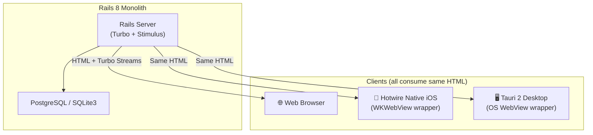

# Trove — Media Inventory with Hotwire & Native Clients

Welcome to **Trove (Media Inventory)**, a modern Ruby on Rails 8.1 web platform designed to catalog personal media collections. The application features an editorial media-centered interface, modular database entities, and supports three clients (Web, iOS, and Desktop) consuming the same server-rendered HTML.

---

## 🚀 Key Features

*   **Editorial design and personal appearance:**
    *   Local **Space Grotesk** headings and **Instrument Sans** body/UI fonts, related to tacobout.online.
    *   Semantic light/dark/system themes, curated violet/ink/moss accents, comfortable/compact density, cover/row layouts, and reduced decorative effects.
    *   Scoped public-profile accents and header treatments, with a live settings preview.
    *   Responsive media grids, deliberate link/button treatments, keyboard focus restoration, and graceful broken-artwork fallbacks.
*   **Safe metadata repair:** Authenticated users can request source-backed refreshes from supported media detail pages. Requests are throttled, child records reconcile in place, and personal history/reviews remain intact.
    *   See [the design and metadata maintenance guide](docs/product-refinement.md) for tokens, supported providers, safeguards, and limits.
*   **Password Authentication & Frictionless Onboarding:**
    *   **Standard Auth:** Secure email + password signup and login flows for standard web browser clients (implemented via `has_secure_password` / `bcrypt`).
    *   **Frictionless Native Onboarding:** On first launch of the iOS or Tauri Desktop app, the backend automatically provisions a local guest account (`Device User`). A signed, permanent cookie (`device_user_id`) keeps the client logged in across app restarts, bypassing signup/login friction.
*   **Modern Hotwire Stack:** Migrated from legacy jQuery/Turbolinks to Rails 8 defaults:
    *   **Turbo Drive & Morphing:** Smooth, instantaneous page transitions with Turbo 8 morphing.
    *   **Turbo Frames & Streams:** Inline pagination and real-time updates for resource creation and lists.
    *   **Stimulus JS:** Modular controllers replacing legacy jQuery handlers, including an interactive iTunes/Google Books cover art thumbnail fetcher.
*   **Hotwire Native iOS App:** A native iOS WKWebView wrapper using the `hotwire-native-ios` SDK. Includes navigation and bridge source; the checked-in Swift package still needs an iOS application target and resource wiring (see the native README).
*   **Tauri 2 Desktop App:** A cross-platform desktop application wrapper targeting macOS, Windows, and Linux. Built with Rust and Tauri 2.
*   **Flexible Database Support:** Uses `DATABASE_ADAPTER` when set; otherwise a `DATABASE_URL` starting with `postgres` selects PostgreSQL, and SQLite3 is the default. Docker Compose supplies a PostgreSQL URL.
*   **Social Integrations:** Built-in support for automated status updates and cross-posting to Mastodon and Bluesky via user-configured credentials.

---

## 📐 Architecture & Client Flow



---

## 📁 Repository Directory Structure

*   `app/`, `config/`, `db/`, `lib/`, `spec/` — Monolithic Rails application files.
*   `native/ios/` — Hotwire Native iOS wrapper project (Swift Package Manager).
*   `native/desktop/` — Tauri 2 desktop app wrapper (Rust + Node CLI).
*   `Dockerfile` — Multi-stage production container build.
*   `docker-compose.yml` — Container configuration for local PostgreSQL + Rails development.
*   `docker-compose.production.yml` — Production environment container configuration.

---

## 🛠️ Getting Started (Local Host Development)

By default, running locally on your host machine will use **SQLite3** for simplicity.

### Prerequisites

*   **Ruby:** Version `3.4.12` (defined in `.ruby-version` and `Gemfile`, with the production image aligned in `Dockerfile`).
*   **Node.js** with `node --test` support for the Rails JavaScript checks; **npm** for the Tauri desktop client.
*   **ImageMagick** with WebP decoding for artwork processing/tests (CI installs it); native gem builds also need compiler tools and PostgreSQL client headers. Browser specs need Chrome and a matching ChromeDriver.

### Setup and Running

1.  **Clone the Repository and Install Gems:**
    ```bash
    cd media_inventory
    bundle install
    ```
2.  **Create the local development schema without demo seeds:**
    ```bash
    RAILS_ENV=development bundle exec rails db:create db:migrate
    ```
    Confirm `DATABASE_URL` and `DATABASE_ADAPTER` select your intended local development database first.

    **Destructive demo seeds:** `db/seeds.rb` calls `delete_all` on users, several media tables, and API configurations. Never seed a database containing data you want to keep. Only for explicitly disposable local development data, after checking the target, run `RAILS_ENV=development bundle exec rails db:seed`. `db:prepare` (including `bin/setup` and container startup) can also load seeds when initializing a database.
3.  **Start the Development Server:**
    ```bash
    bin/dev
    ```
    *(This starts both the Rails server and the Dart Sass CSS watcher so stylesheets compile automatically on modification).*
4.  **Open the Application:**
    Navigate to [http://localhost:3000](http://localhost:3000) in your browser.

---

## 🐳 Running with Docker (PostgreSQL)

The Compose configuration uses **PostgreSQL 17**, distinct from CI’s PostgreSQL 11 service and Fly’s SQLite volume. Its startup runs `db:prepare`, which can load destructive demo seeds on initialization. Use a fresh, explicitly disposable local development database/volume only.

The shared `Dockerfile` installs production gems only (`BUNDLE_WITHOUT=development:test`); the development Compose file does not override that setting. It is not a complete development/test image as checked in. To inspect this configuration:

1.  **Validate the Compose configuration:**
    ```bash
    docker compose config --quiet
    ```
    Review the gem-group configuration before attempting development startup. The configured web port is 3000.

---

## 📱 Running the iOS App (Xcode)

See [the iOS setup and current limitations](native/ios/README.md). The repository contains Swift package source for iOS 18+, not a ready-to-run Xcode application project.

---

## 🖥️ Running the Desktop App (Tauri 2)

### Prerequisites
*   Install **Rust** via [rustup](https://rustup.rs).
*   For Windows/Linux platform prerequisites, see [Tauri Prerequisites](https://v2.tauri.app/start/prerequisites/).

### Setup and Running

1.  **Navigate to the Desktop folder and install dependencies:**
    ```bash
    cd native/desktop
    npm install
    ```
2.  **Generate application icons (optional — already generated):**
    ```bash
    npx tauri icon app-icon.png
    ```
3.  **Run the Tauri app in development mode:**
    Make sure your Rails server is running on `localhost:3000` first, then run:
    ```bash
    npm run dev
    ```
4.  **Build a production release binary:**
    ```bash
    npm run build
    ```

---

## 🧪 Testing & Quality Assurance

*   **RSpec Test Suite:** Includes request, service, model, and system specs. Before schema loading or tests, ensure `DATABASE_URL` targets a dedicated disposable test database, never development or production data. For an isolated local SQLite test database:
    ```bash
    RAILS_ENV=test DATABASE_ADAPTER=sqlite3 DATABASE_URL=sqlite3:db/docs_test.sqlite3 bundle exec rails db:schema:load
    RAILS_ENV=test DATABASE_ADAPTER=sqlite3 DATABASE_URL=sqlite3:db/docs_test.sqlite3 bundle exec rails dartsass:build
    RAILS_ENV=test DATABASE_ADAPTER=sqlite3 DATABASE_URL=sqlite3:db/docs_test.sqlite3 bundle exec rspec
    ```
*   **Linter Checks:** Run RuboCop static analysis checks to verify code style:
    ```bash
    bundle exec rubocop
    ```

*   **JavaScript and public contact checks:**
    ```bash
    node --test spec/javascript/*.test.cjs spec/javascript/*.test.mjs
    python3 scripts/check_public_email.py
    ```

CI (`.github/workflows/rubyonrails.yml`) tests PostgreSQL and SQLite, builds Sass, runs a separate browser regression list with `RUN_BROWSER_SPECS=1`, checks RuboCop/Brakeman/bundler-audit, and builds/checks the production image. On GitHub Actions the initial suite excludes system specs; locally the full RSpec command includes them and requires Chrome/ChromeDriver. See the workflow for the current browser file list and driver environment variables.

## Deployment configuration

`Dockerfile` builds the production image. `docker-compose.production.yml` requires `POSTGRES_PASSWORD` and `SECRET_KEY_BASE` in the environment. `fly.toml` instead configures SQLite at `/data/production.sqlite3` on a persistent `/data` volume and runs `db:prepare` as its release command. These are deployment configurations, not evidence of a deployment’s current state. Review database targets, seed behavior, persistent storage, and secrets before any separately authorized deployment.

Coding agents should start with [AGENTS.md](AGENTS.md).
