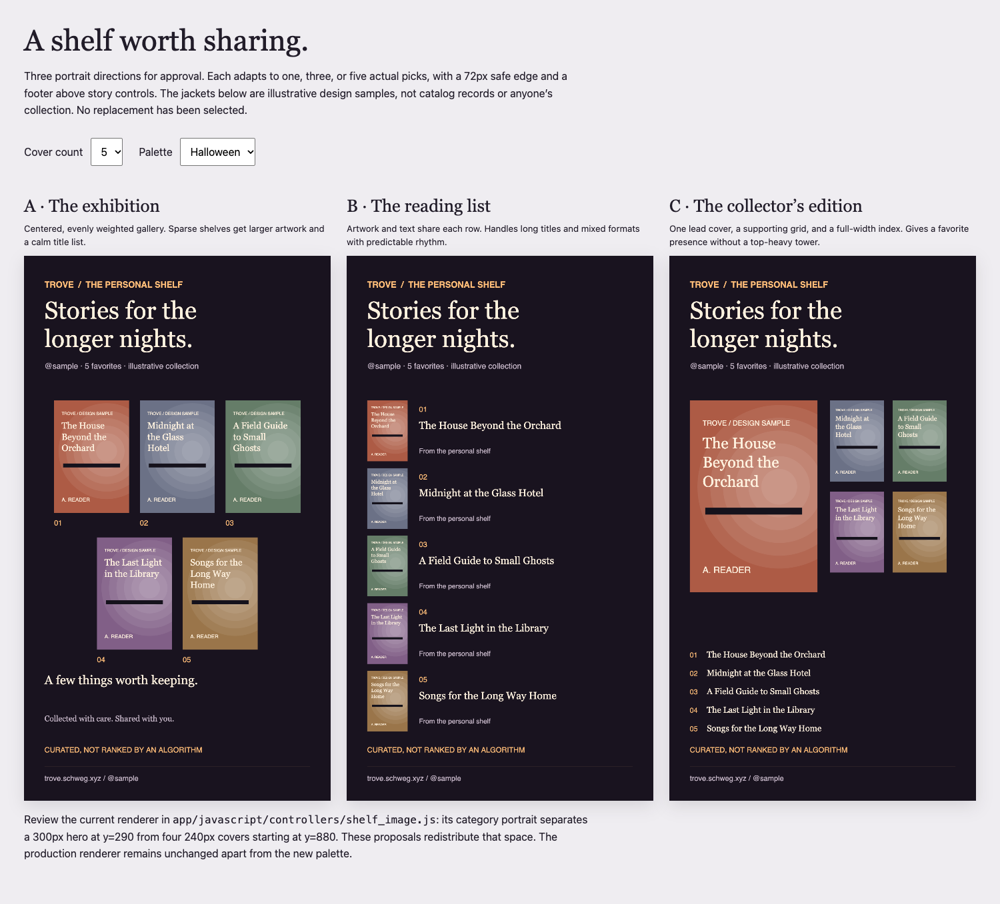
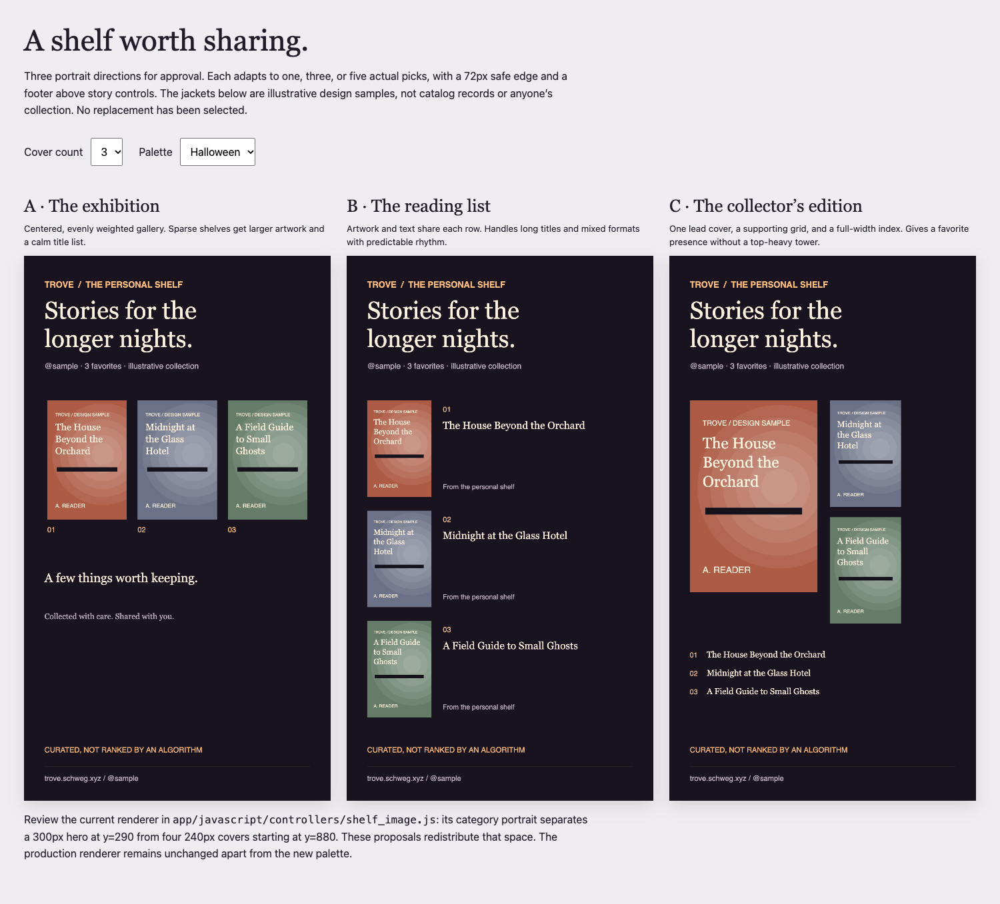
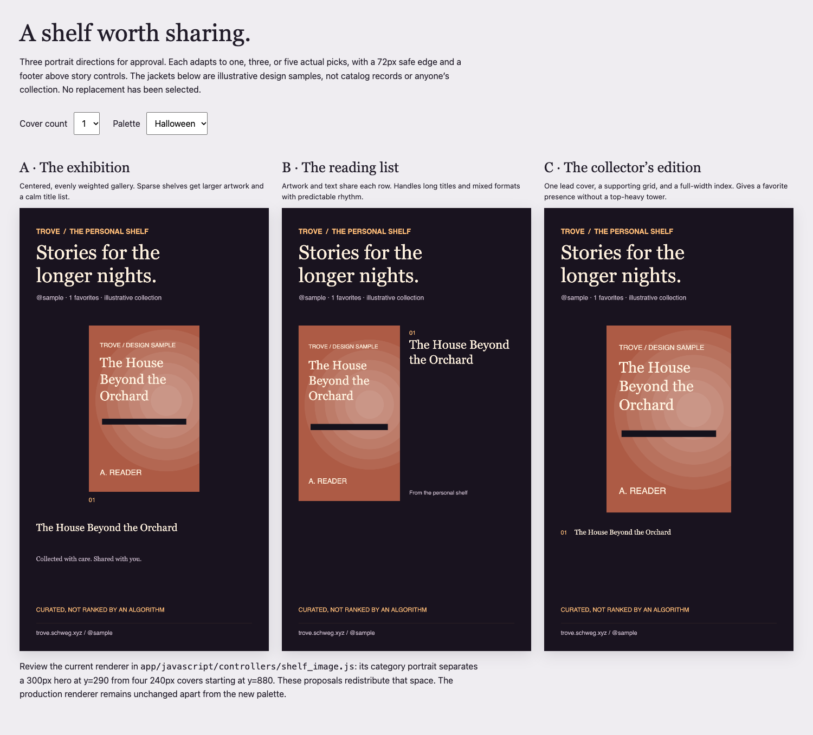

# Shelf social image options — approval pending

The live shelf and export renderer is `app/javascript/controllers/shelf_image.js`. Its category portrait currently uses one 300px cover at y=290 and four 240px covers beginning at y=880; the overview uses one larger row and five smaller category rows. These alternatives address the category portrait's large vertical gap without changing the live renderer.

Open `shelf-social-options.html` through a local static server (for example `python3 -m http.server`) to compare three directions, 1/3/5 cover counts, and Halloween/Gallery/Midnight palettes. Jackets are illustrative design samples; no real user collection is claimed.

- **A · The exhibition:** evenly weighted centered gallery, two rows for five picks, larger art for sparse shelves.
- **B · The reading list:** consistent art/text rows, strongest text readability and mixed-format flexibility.
- **C · The collector’s edition:** hero plus supporting mosaic, with a separate readable title index.

All examples use 1080×1920 canvases, 72px side margins, and a clear footer. Before selecting a production replacement, review full-size images and test real mixed-format artwork, long titles/handles, empty shelves, and all six overview categories. Only the Halloween color palette is implemented in production.

